<a href="https://cloaki.de">
<picture><source media="(prefers-color-scheme: dark)" srcset="bilder/kopf-dunkel.svg"></picture>
</a>

## Hallo, ich bin Cloaki

Ich bin Furry, Gamer und Streamer aus Deutschland. Hier liegt der Quelltext von dem, was ich baue: vor allem InNoteBox, meine Notizen-App für Android, und Solid Self, eine Mod für Minecraft.

Hi, I’m Cloaki, a furry, gamer and streamer from Germany. This is where the code of my projects lives: InNoteBox, a note app for Android, and Solid Self, a mod for Minecraft.

### Projekte

<a href="https://github.com/Cloakyi/innotebox"><picture><source media="(prefers-color-scheme: dark)" srcset="bilder/innotebox-dunkel.svg"></picture></a>
<a href="https://github.com/Cloakyi/solid-self"><picture><source media="(prefers-color-scheme: dark)" srcset="bilder/solid-self-dunkel.svg"></picture></a>

### Wo du mich findest

<a href="https://www.twitch.tv/cloakiy"><picture><source media="(prefers-color-scheme: dark)" srcset="bilder/link-twitch-dunkel.svg"></picture></a>
<a href="https://www.youtube.com/@Cloaki"><picture><source media="(prefers-color-scheme: dark)" srcset="bilder/link-youtube-dunkel.svg"></picture></a>
<a href="https://www.tiktok.com/@cloakiy"><picture><source media="(prefers-color-scheme: dark)" srcset="bilder/link-tiktok-dunkel.svg"></picture></a>
<a href="https://discord.gg/suwEMTC9b7"><picture><source media="(prefers-color-scheme: dark)" srcset="bilder/link-discord-dunkel.svg"></picture></a>
<a href="https://www.instagram.com/cloakiy/"><picture><source media="(prefers-color-scheme: dark)" srcset="bilder/link-instagram-dunkel.svg"></picture></a>
<a href="https://x.com/Cloakiy"><picture><source media="(prefers-color-scheme: dark)" srcset="bilder/link-x-dunkel.svg"></picture></a>
<a href="https://t.me/Cloakiy"><picture><source media="(prefers-color-scheme: dark)" srcset="bilder/link-telegram-dunkel.svg"></picture></a>
<a href="https://open.spotify.com/user/31a53fsu43a64ggmtlikz2on4qey"><picture><source media="(prefers-color-scheme: dark)" srcset="bilder/link-spotify-dunkel.svg"></picture></a>
<a href="https://steamcommunity.com/id/Cloakiy"><picture><source media="(prefers-color-scheme: dark)" srcset="bilder/link-steam-dunkel.svg"></picture></a>
<a href="https://vrchat.com/home/user/usr_fa6e084d-9235-4492-a748-78da4c5d7ada"><picture><source media="(prefers-color-scheme: dark)" srcset="bilder/link-vrchat-dunkel.svg"></picture></a>
<a href="https://modrinth.com/user/Cloaki"><picture><source media="(prefers-color-scheme: dark)" srcset="bilder/link-modrinth-dunkel.svg"></picture></a>
<a href="https://cloaki.de"><picture><source media="(prefers-color-scheme: dark)" srcset="bilder/link-cloaki-dunkel.svg"></picture></a>

### Kontakt

Fragen und Fehler zu InNoteBox gehen an [support@cloaki.de](mailto:support@cloaki.de), alles andere an [info@cloaki.de](mailto:info@cloaki.de). Fehler in Solid Self meldest du am besten [direkt im Projekt](https://github.com/Cloakyi/solid-self/issues/new/choose).

<a href="https://github.com/Cloakyi/innotebox/releases">
<picture><source media="(prefers-color-scheme: dark)" srcset="bilder/neu-dunkel.svg"></picture>
</a>

Die Bilder dieser Seite zeichnet ein kleines Skript in diesem Repository, und jeden Morgen holt es sich den neuesten Stand meiner Projekte. [Impressum](https://cloaki.de/impressum/) · [Datenschutz](https://cloaki.de/datenschutz/)
